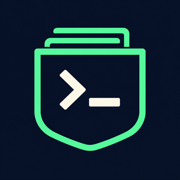
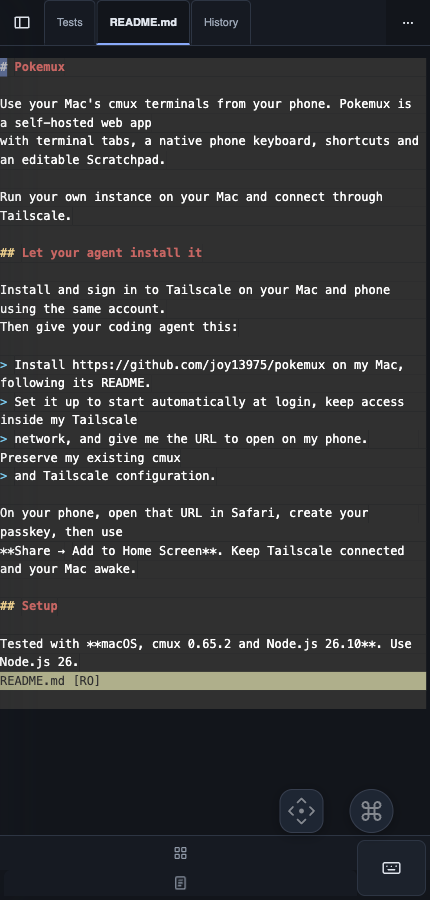
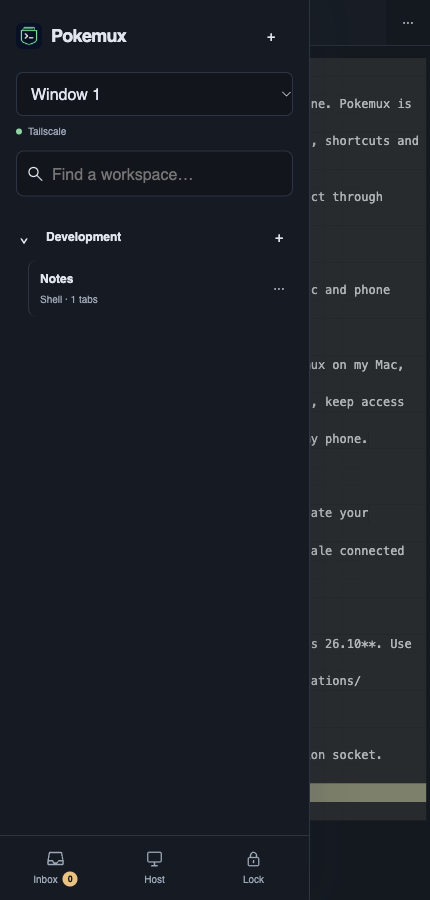
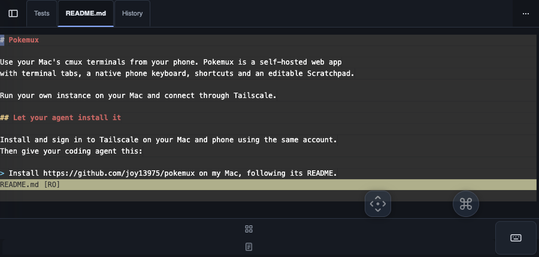
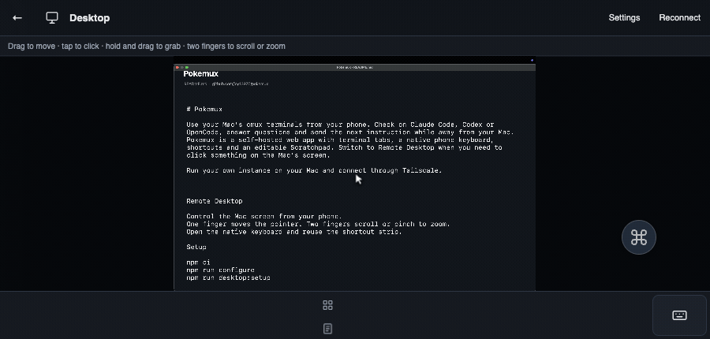

# Pokemux

Use your Mac's cmux terminals from your phone. Check on Claude Code, Codex or
OpenCode, answer questions and send the next instruction while away from your Mac.
Pokemux is a self-hosted web app with terminal tabs, a native phone keyboard,
shortcuts and an editable Scratchpad. Switch to Remote Desktop when you need to
click something on the Mac's screen.

Run your own instance on your Mac and connect through Tailscale.

## Screenshots

A live cmux terminal running Vim with this public README. The terminal redraws
for the available screen size, including after rotating to landscape.

<table>
  <tr>
    <th>Phone-sized terminal</th>
    <th>Workspace sidebar</th>
    <th>Shortcuts</th>
  </tr>
  <tr>
    <td></td>
    <td></td>
    <td></td>
  </tr>
</table>



## Image paste

Copy an image on your phone, then open **⌘ → Paste**. Confirm Safari's Paste
prompt if shown. Native Paste also works in the terminal and Scratchpad.
Pasting an image into the Scratchpad sends it to the active terminal while
keeping your text draft.

Pokemux transfers the image to a private temporary file on your Mac and inserts
its path. The TUI must support images from local file paths. Image paste does
not press Enter.

## Desktop

Open the sidebar and choose **Desktop** to control the Mac's main display.
It is one screen, with the same floating keyboard control and shortcut strip
as the terminal view. Use the back arrow to return to your terminals.

Live Mac screen, viewed from Pokemux in landscape. [Still screenshot](docs/screenshots/desktop.png).



- Drag one finger to move the pointer; tap to click.
- Hold to right-click, or hold and move to drag.
- Use two fingers to scroll; pinch to zoom into the screen.
- The pointer stays centered while the zoomed desktop pans beneath it, until
  a desktop edge is reached. Lifting one finger returns to pointer movement.
- Adjust **Pan sensitivity** and **Pinch sensitivity** in **Settings → Desktop**.
- Open the native keyboard with **⌘ → Show keyboard** or the keyboard button.
  Tapping the desktop keeps the keyboard as it is.

Desktop streaming uses [screen-relay](https://github.com/vercel-labs/screen-relay).
After installing Pokemux's dependencies, set up its Mac engine once:

```sh
npm run desktop:setup
```

This builds the engine with Homebrew and the Xcode Command Line Tools. Grant
**Screen & System Audio Recording** and **Accessibility** to the app that starts
the bridge when macOS asks. Restart the bridge after granting permissions.
For the background LaunchAgent, add the Node executable (`command -v node`)
to both permission lists using **+ → ⌘⇧G**. Permissions granted to Terminal
or a coding agent do not carry over to the background service.
The engine listens only on loopback; Pokemux protects its stream with the existing
passkey session and Tailscale URL. Its native dependencies retain their upstream
licenses; see screen-relay's third-party notices.

## Open links and files on your phone

Tap a visible URL, or select a URL and hold the selection, to open a new browser
tab. Select a full Mac file path (`/…`, `~/…` or `file://…`) and hold it to open
the file on your phone. PNG, JPEG, GIF and WebP images preview; other files
download. Your Pokemux terminal tab stays open.

Hidden destinations behind TUI link labels are unavailable in cmux's current
terminal stream. Relative file paths also need their full Mac path.

## Let your agent install it

Install and sign in to Tailscale on your Mac and phone using the same account.
Then give your coding agent this:

> Install https://github.com/joy13975/pokemux on my Mac, following its README.
> Set it up to start automatically at login, keep access inside my Tailscale
> network, and give me the URL to open on my phone. Preserve my existing cmux
> and Tailscale configuration.

On your phone, open that URL in Safari, create your passkey, then use
**Share → Add to Home Screen**. Keep Tailscale connected and your Mac awake.

## Setup

Tested with **macOS, cmux 0.65.2 and Node.js 26.10**. Use Node.js 26.
Install the macOS Tailscale app in `/Applications/Tailscale.app` and enable
Tailscale HTTPS when prompted.

1. Start cmux and enable its local automation socket. Pokemux expects
   `~/.local/state/cmux/cmux.sock`; `cmux ping` must succeed.
2. Clone and configure:

   ```sh
   git clone https://github.com/joy13975/pokemux.git
   cd pokemux
   npm ci
   npm run configure
   npm start
   ```

3. In another terminal, expose the loopback service to your tailnet:

   ```sh
   /Applications/Tailscale.app/Contents/MacOS/Tailscale serve --bg http://127.0.0.1:4388
   ```

   Open the HTTPS URL Tailscale prints on your phone. Use **Serve**, which is
   private to your tailnet. Do not enable Funnel. If this host already serves
   another app at that URL, stop and resolve the conflict before changing it.

4. For automatic startup, have your agent create a user LaunchAgent. Its
   `ProgramArguments` must contain the absolute Node executable and this clone's
   `server.mjs`; its `WorkingDirectory` must be this clone. Set `RunAtLoad` and
   `KeepAlive` to true, and put stdout/stderr logs in this clone's `state/`.
   Stop the foreground server before loading the LaunchAgent, then verify the
   phone URL again.

The bridge listens only on `127.0.0.1:4388`. Configuration discovers your own
Tailscale identity and hostname; the first passkey must be created through that
owner's Tailscale connection. Tagged client devices are unsupported for first
registration.

## Updates and troubleshooting

- Update with `git pull --ff-only` and `npm ci`, then restart your LaunchAgent.
- Keep `state/`: it contains your configuration, passkeys and login sessions.
  These files are private and ignored by Git.
- If the page cannot connect, check that cmux is running, `cmux ping` succeeds,
  and Tailscale is connected on both devices. Read the LaunchAgent's logs in
  `state/`, or run `npm start` in a terminal to see the error.
- Phone-fit resizes the shared terminal, so the host TUI can redraw too.
- To remove Pokemux, unload its LaunchAgent and remove only its Tailscale Serve
  route before deleting the clone. Do not reset other apps' Serve routes.

## Development

Run `npm test`. Browser and cmux integration tools are in `tests/`; fixtures
create disposable terminals and must clean up their own workspaces.
With the Desktop engine installed and permissions granted, run
`node tests/desktop-live.mjs` to check engine restart and credential cleanup.

## License

[MIT](LICENSE). Bundled third-party assets retain their licenses in `vendor/`.
