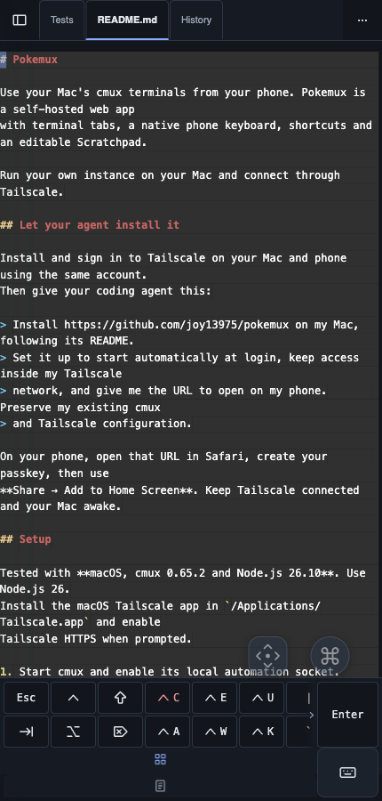

# Pokemux

Use your Mac's cmux terminals from your phone. Pokemux is a self-hosted web app
with terminal tabs, a native phone keyboard, shortcuts and an editable Scratchpad.

Run your own instance on your Mac and connect through Tailscale.

## Screenshots

A live cmux terminal running Vim with this public README. The terminal redraws
for the available screen size, including after rotating to landscape.

<table>
  <tr>
    <th>Phone-sized terminal</th>
    <th>Workspace sidebar</th>
    <th>Shortcuts</th>
  </tr>
  <tr>
    <td></td>
    <td></td>
    <td></td>
  </tr>
</table>


## Let your agent install it

Install and sign in to Tailscale on your Mac and phone using the same account.
Then give your coding agent this:

> Install https://github.com/joy13975/pokemux on my Mac, following its README.
> Set it up to start automatically at login, keep access inside my Tailscale
> network, and give me the URL to open on my phone. Preserve my existing cmux
> and Tailscale configuration.

On your phone, open that URL in Safari, create your passkey, then use
**Share → Add to Home Screen**. Keep Tailscale connected and your Mac awake.

## Setup

Tested with **macOS, cmux 0.65.2 and Node.js 26.10**. Use Node.js 26.
Install the macOS Tailscale app in `/Applications/Tailscale.app` and enable
Tailscale HTTPS when prompted.

1. Start cmux and enable its local automation socket. Pokemux expects
   `~/.local/state/cmux/cmux.sock`; `cmux ping` must succeed.
2. Clone and configure:

   ```sh
   git clone https://github.com/joy13975/pokemux.git
   cd pokemux
   npm ci
   npm run configure
   npm start
   ```

3. In another terminal, expose the loopback service to your tailnet:

   ```sh
   /Applications/Tailscale.app/Contents/MacOS/Tailscale serve --bg http://127.0.0.1:4388
   ```

   Open the HTTPS URL Tailscale prints on your phone. Use **Serve**, which is
   private to your tailnet. Do not enable Funnel. If this host already serves
   another app at that URL, stop and resolve the conflict before changing it.

4. For automatic startup, have your agent create a user LaunchAgent. Its
   `ProgramArguments` must contain the absolute Node executable and this clone's
   `server.mjs`; its `WorkingDirectory` must be this clone. Set `RunAtLoad` and
   `KeepAlive` to true, and put stdout/stderr logs in this clone's `state/`.
   Stop the foreground server before loading the LaunchAgent, then verify the
   phone URL again.

The bridge listens only on `127.0.0.1:4388`. Configuration discovers your own
Tailscale identity and hostname; the first passkey must be created through that
owner's Tailscale connection. Tagged client devices are unsupported for first
registration.

## Updates and troubleshooting

- Update with `git pull --ff-only` and `npm ci`, then restart your LaunchAgent.
- Keep `state/`: it contains your configuration, passkeys and login sessions.
  These files are private and ignored by Git.
- If the page cannot connect, check that cmux is running, `cmux ping` succeeds,
  and Tailscale is connected on both devices. Read the LaunchAgent's logs in
  `state/`, or run `npm start` in a terminal to see the error.
- Phone-fit resizes the shared terminal, so the host TUI can redraw too.
- To remove Pokemux, unload its LaunchAgent and remove only its Tailscale Serve
  route before deleting the clone. Do not reset other apps' Serve routes.

## Development

Run `npm test`. Browser and cmux integration tools are in `tests/`; fixtures
create disposable terminals and must clean up their own workspaces.

## License

[MIT](LICENSE). Bundled third-party assets retain their licenses in `vendor/`.
